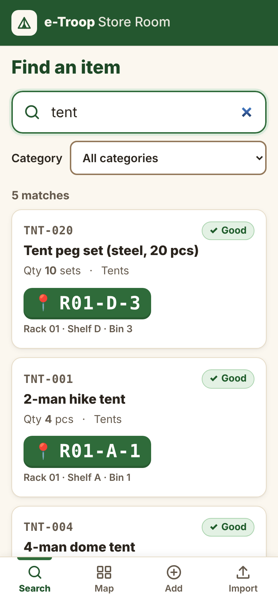
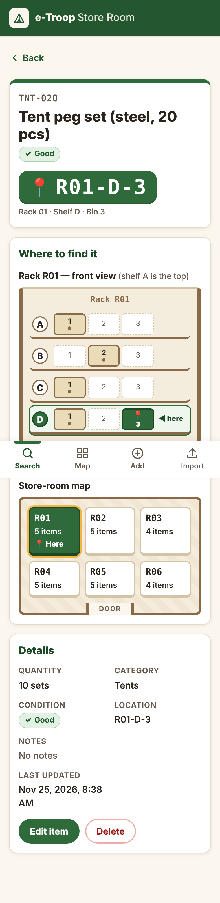

# e-Troop Store Room

A store-room app for a scout troop quartermaster. Each item has an **item code** and a **rack coordinate** (e.g. `R03-B-2` = Rack 03, Shelf B, Bin 2). You can search for an item by name or code and see exactly where it's kept, highlighted on a drawing of the rack and the store-room map.

<p>
  
  
</p>

## Phase 1 features
- **Search:** results appear as you type, each with a big location badge
- **Item detail:** rack diagram with the shelf and bin highlighted, plus the store-room map
- **Map and Rack views**
- **Add / Edit / Delete items**
- **Excel / CSV import:** English or Malay column names, loose location formats, a preview before saving, and a downloadable template

Planned for Phase 2+: check-in/out log, members and login, maintenance log, QR labels, stocktake.

## Run it locally
You need Node.js 22 or newer. Start the backend in one terminal:
```bash
cd backend && npm install && npm run seed && npm run dev
```
Then the frontend in a second terminal:
```bash
cd frontend && npm install && npm run dev
```
Open http://localhost:5173. The backend runs on port 3001.

## Tests
```bash
cd backend && npm test
```
```bash
cd frontend && npm test && npm run e2e
```

## Project docs
- `docs/SPEC.md`: the API contract and behaviour
- `docs/TEAM-SUMMARY.md`: what each subagent built, reviewed and tested
- `docs/REVIEW-*.md`, `docs/TEST-*.md`: review and test reports
- `.claude/agents/`: the six subagent roles (frontend/backend developer, reviewer and tester)
